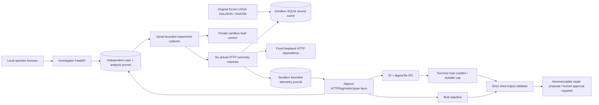

# Faultline architecture

Both app services belong only to this project. Sandbox has no published port and uses its own SQLite volume. Investigator publishes127.0.0.1:8286, has separate case storage, and talks only to the fixed sandbox service. The source is read-only in the sandbox; no service sees model credentials, Docker socket, host home, employer data or another project's DB. Normal Docker bridge networking enables loopback publishing; this is not a claim of network egress isolation. There is no arbitrary URL/command/code-execution interface. The sandbox dependency URL is fixed loopback.

Collector performs3normal then3scenario requests serially, captures client elapsed time and matches each response to a distinct canonical capture/trace identity. Telemetry includes a rooted acyclic span tree, actual durations/error types and linked logs. Status agreement and ownership are validated before evidence construction. Facts are derived from the measurements; operator scenario names remain outside the model bundle. Original source bytes/required cache hash are checked; cache corruption is unhealthy, never silently reseeded. Sandbox journal caps200records; captured cases persist their complete copied records independently of later eviction.

The collector always attempts to reset the injected control in finally. An investigator crash may skip finally; restart performs a bounded normal-reset attempt, records cleanup success/failure and fails the interrupted capture without repeating requests. This cleanup is part of the authorized experiment lifecycle; proposed code repairs are separate records and are never executed. A new capture begins from normal control. No hidden production repair integration exists.

Model requests contain UUID identities, fixed probe enum, evidence fingerprints and expiry. Host validates source pin and bounded immutable file, reconstructs only this lab's evidence and fixed question, then invokes approved cookllm with no tools/one turn/100s timeout. Host control ledger is unmounted and records before invocation. Investigator reserves10lifetime model attempts/3pending before publication. It preserves intact pending identities, consumes completed responses first, refuses missing/changed/expired requests and reconciles terminal IPC after crash. No inference retry or provider fallback. Model latency/tokens are retained even when output fails validation; bounded rejected text remains locally inspectable as untrusted output.

Validator requires exact contiguous quote references across at least2modalities, cautious confidence, alternatives/uncertainty and a compatible repair key. It refuses unknown command/patch/approval fields, canary leakage, unbounded structures and invented evidence. Exact strings do not prove semantic support: independent semantic review and scenario evaluation remain necessary. The selected repair key resolves to a trusted concrete plan/risk/test template; `requires_approval=true`, `executable=false`. No approval or apply endpoint exists, so a model or browser flag cannot authorize execution.

State limits:40cases/2pending captures;160analysis records;10lifetime model reservations/3pending; bounded6request captures and<=30facts/40KB bundle;200sandbox journal records; model/IPC/request byte limits. Source fingerprints, code hashes, case/trace IDs, raw observations and model outputs allow local reproduction and honest failure inspection. Alias backend version/dollar charges are unavailable. Held-out captures are new runtime instances of known lab fault families.
